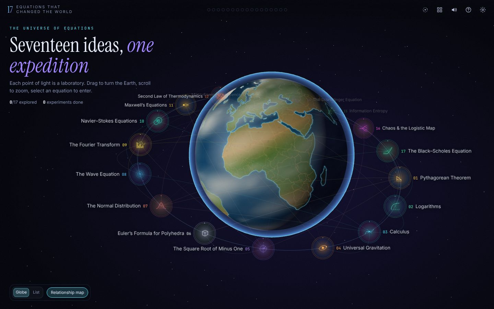
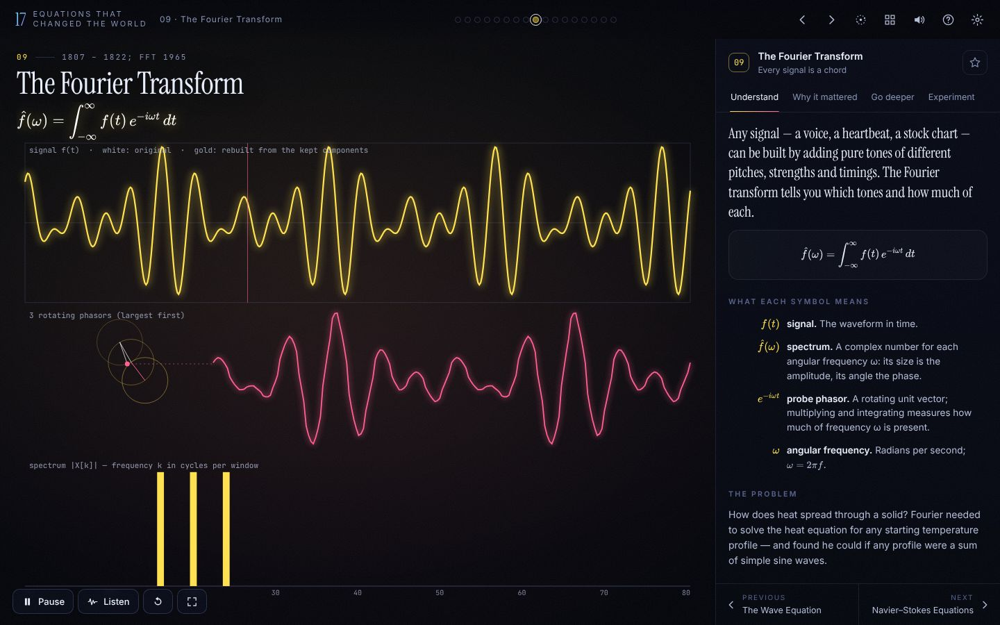

<div align="center">

# 17 Equations That Changed the World

**Change one variable in an equation and watch the world move.**

Seventeen interactive labs, from Pythagoras to Black–Scholes. Free, offline, open source.

[](LICENSE)
[](https://github.com/atomictime01-netizen/17-equations/actions/workflows/ci.yml)
[](https://github.com/atomictime01-netizen/17-equations/stargazers)
[](https://buymeacoffee.com/atomictime)

[**Open the app**](https://atomictime01-netizen.github.io/17-equations/app/) · [Landing page](https://atomictime01-netizen.github.io/17-equations/) · [Pricing](https://atomictime01-netizen.github.io/17-equations/pricing.html)

</div>

<p align="center">
  
  
</p>

Every equation is a small laboratory driven by a real mathematical model: change a variable and the mathematics, the numbers and the picture respond together.

## Why it is different

- **The solvers are real, and tested.** Navier–Stokes runs a 2-D fluid solver in a Web Worker, the wave equation is stepped with a Courant-safe time step, and the FFT is checked against a direct DFT. 35 automated tests compare the models with independent results.
- **Nothing leaves your browser.** No account, no API keys, no network calls at run time. Fonts, KaTeX, Three.js and the map data are bundled, and a service worker makes it work offline after the first visit.
- **The experiments notice what you did.** Guided experiments detect when you have actually done them, or switch to discovery mode and wander. Every simulation states its simplifications under *Limits & caveats*.

## Quickstart

```bash
git clone https://github.com/atomictime01-netizen/17-equations.git
cd 17-equations && npm install
npm run dev        # http://localhost:5173
```

Other commands: `npm test` (model and content tests), `npm run build` (type-check + production build into `dist/`), `npm run preview`, `npm run offline` (build and serve with no connection), and `npm run site:build` (landing page + pricing + the app under `/app/`, into `site-dist/`).

No accounts, API keys or external services are needed.

## Working offline

Nothing in the site touches the internet at run time: fonts, KaTeX, Three.js and the world map data are all bundled.

- **Installed copy, no connection at all:** after `npm install` (the only step that needs internet), run `npm run offline`. It builds the site and opens it from a local server.
- **Browser offline cache:** the production build includes a service worker that caches the whole app (about 2 MB) on the first visit. After that, the site loads and runs with the network off, and supporting browsers offer to install it as an app.
- `npm run dev` never needs a connection either, though it skips the service worker so changes always show up straight away. Progress, bookmarks and settings live in the browser's local storage.

## The experience

- **Introduction** — a Three.js particle field that assembles into a Pythagorean figure, a rippling wave field, Keplerian orbits and the complex helix of *e^{iθ}*, then resolves into a galaxy behind the title. Skippable; returning visitors land straight on the title.
- **The universe** — a 3-D Earth (textured procedurally in the browser from bundled Natural Earth 1:110m geography) that you drag to turn and scroll to zoom, ringed by the 17 equations as orbiting satellites. Hover a satellite or a link to see why two equations are connected; progress rings show what you have explored, and a list view suits small screens.
- **Each experience** has the same four layers — *See it* (an opening demonstration), *Understand* (every symbol explained), *Experiment* (controls, live readouts, guided experiments that detect when you have done them) and *Why it mattered* (history, applications, connections, caveats) — plus *Go deeper* derivations and notes on the numerical method.
- **Navigation** — persistent top bar with progress dots, previous/next, index, help, settings and mute. Keyboard: `←/→` previous/next, `U` universe, `I` index, `M` mute, `?` help, `Esc` close.
- **Settings** — guided vs discovery mode, reduced motion (follows the OS by default), rendering quality, sound, reset progress, replay intro.

## The models

| # | Equation | Model / method |
|---|----------|----------------|
| 01 | Pythagoras | Draggable right triangle; area-tile flow; Euclid I.47 as exact shear + translation maps; rigid rearrangement proof; coordinate distance |
| 02 | Logarithms | Linear↔log ruler morph, any base; working slide rule; cosmic distance and decibel scales |
| 03 | Calculus | Tangent vs secant (h → 0), left/right/midpoint/trapezoid Riemann sums vs exact integrals, derivative and accumulated-area plots, natural-spline freehand functions |
| 04 | Gravitation | Two-body velocity-Verlet in AU / years / M☉ (G = 4π²); force in newtons; Kepler period, eccentricity, escape; variable force exponent |
| 05 | √−1 | Complex plane: ×i rotation, multiplication as rotation + scaling, Euler's formula with series partial sums, phasors |
| 06 | Euler polyhedra | Three.js solids built from vertex/face lists; V, E, F counted from structure; χ-preserving surgeries; polyhedral torus (χ = 0) |
| 07 | Normal distribution | Box–Muller sampling, histogram convergence, interval probabilities via erfc, sum-of-uniforms CLT source |
| 08 | Wave equation | Leapfrog FDTD with automatic Courant-safe time step; 2-D membrane (GPU-shaded heightfield) with fixed/free/absorbing boundaries, sources, double slit, eigenmodes; 1-D string with harmonics and resonance |
| 09 | Fourier transform | Radix-2 FFT (tested against a direct DFT), epicycles, partial sums, brick-wall filters, inverse FFT, drawn signals, optional audio |
| 10 | Navier–Stokes | 2-D incompressible MAC-grid solver in a Web Worker: RK2 semi-Lagrangian advection, implicit viscosity, SOR pressure projection; dye, speed, pressure, vorticity, streamlines |
| 11 | Maxwell | Exact 2-D line-charge and wire fields with numerically integrated flux/circulation checks; Faraday induction in a solenoid; 1-D Yee FDTD light wave with a displacement-current toggle |
| 12 | Second law | Hard-disc gas with elastic collisions; Boltzmann entropy ln Ω from coarse-grained occupancies; velocity reversal |
| 13 | E = mc² | Exact SI rest energy, unit conversions, sourced comparison scales, process efficiencies, relativistic γ |
| 14 | Schrödinger | Finite-difference Hamiltonian diagonalised by Sturm bisection + inverse iteration (electron, nm, eV, fs); eigenstates, superpositions, wave-packet tunnelling via exact eigenbasis evolution |
| 15 | Shannon entropy | Entropy in bits, surprisal, Huffman tree and average code length, encoded symbol stream |
| 16 | Logistic map | Real iteration: progressively built bifurcation diagram with zoom, Lyapunov exponent curve, cobweb, sensitivity to initial conditions |
| 17 | Black–Scholes | Closed-form prices and Greeks, Three.js value surface, Crank–Nicolson PDE solution (Rannacher start-up) compared with the formula |

Every simulation states its simplifications in the interface under *Limits & caveats*. Nothing here is investment advice.

## Architecture

```
src/
  math/          pure, tested models (FFT, quantum eigensolver, fluid solver, wave FDTD, gravity, …)
  workers/       fluid solver Web Worker
  core/          store (localStorage), audio engine, router, canvas/animation hooks, drawing helpers
  components/    shell, intro, universe, navigation, overlays, controls, KaTeX rendering
  experiences/   one code-split component per equation
  data/          narrative content for all 17 equations
```

- React 18 + TypeScript + Vite; Three.js for 3-D scenes; Canvas 2-D for plots; KaTeX for typesetting.
- Animation loops run through refs and `requestAnimationFrame`, so React does not re-render every frame; canvases pause when off-screen or when the tab is hidden.
- Each experience is lazy-loaded and wrapped in an error boundary, so one failing scene cannot take down the site.
- Sound is procedural Web Audio and never starts before a user gesture.

## Tests

`npm test` runs Vitest suites that check the models against independent results — e.g. FFT vs direct DFT and Parseval's theorem, Black–Scholes textbook prices, put–call parity and the PDE solver, infinite-well and harmonic-oscillator energies, logistic-map periods and Lyapunov exponents, Gauss/Ampère/Faraday integrals, Yee wave speed, χ for every solid and surgery, fluid incompressibility, wave-energy conservation, Kepler's one-year orbit — plus integrity checks on the narrative content.

## Contributing

Bug reports, fixes, clearer explanations and new experiments are welcome. Read [CONTRIBUTING.md](CONTRIBUTING.md) for setup and PR rules, and follow the [Code of Conduct](CODE_OF_CONDUCT.md). Report security issues privately, as described in [SECURITY.md](SECURITY.md). The history of changes is in [CHANGELOG.md](CHANGELOG.md).

## Support

17 Equations is free and stays free. If it taught you something, you can [buy me a coffee](https://buymeacoffee.com/atomictime), or just star the repo and share it with a teacher.

## License

[MIT](LICENSE) © 2026 atomictime01-netizen. General information, not legal advice.

Third-party code and assets keep their own licences, all permissive: React, Three.js and KaTeX (MIT); d3-geo, topojson-client and world-atlas (ISC; the map is derived from Natural Earth, which is public domain); and the Inter, JetBrains Mono and Instrument Serif fonts (SIL Open Font License 1.1). Run `npm ls --all` for the full dependency tree.
